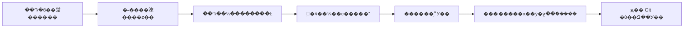

# �ܹ����

## ���Ŀ��

һ�������ܿ����Ķ����ɼ����ܳ���׷�ӡ�ÿ���۵��ܻص�������С�����ϲֿ⡣�� JSON ��Ψһ��ʵ���ݣ���ȷ���� Python ���� Markdown�����������ݿ⡢����˻򸶷� API��

## ��������

1. **Theory**���ȶ� ID�����ơ�������״̬����ǰժҪ��������Դ�������õĹ۵�ʹ�������⡣����֪ʶ�����޶���Git �����汾���졣
2. **Source**��������Դ ID���淶��ַ�����ߡ���Դ���ԭʼ����ʱ�䡢�״η������ڡ��˶�״̬����дժҪ����ҳ�仯������Դ��¼�� `supersedes` �����ɰ棬ͬһ URL ���ж���汾���ɼ�¼�����ǡ�
3. **Event**��ֻ׷�ӵ��¼����������ۺ���Դ�����ֳ�ʼ����������Դ���۵��޶��������ۡ���ѡ���ֺ;��������־������������·����������¡�
4. **Run**��ÿ�μ����ĸ���ʱ�䡢ִ��ʱ�䡢��ѯ����ʽ����ʧ����¼� ID����ʹ���¼�Ҳ����������ʧ�ܲ��ƽ���������ˮλ��

## ������

## �����۷���

�����еķ��ֲ�ѯ�����ȣ�ԭ�����������������ĸ�����ȡ��������Ƚ� `candidate`���пɺ˶��Ķ��塢��ʶ�𷢲�����򴫲������ġ���������������ֺ���Ϊ `tracked`������ἰ������ʵ��֤����ֻ�Ľз������ݹ�Ϊ�������۱���������Ϊ���������ۡ�

## �����뷢��

һ��������ץȡԶ�� main�����Ǵ��ڴ��ϴ� `complete` �Ľ�ֹʱ����� 48 Сʱ��ʧ����־���洰�ڲ��顣����ʱ�䲻�������������鵵����ȷΪ���·��֣�����ʱ�����ʵ����ÿ�ջ��ܰ� Asia/Shanghai ����������֯��ͬ���������� run/event ID��������ԭ��־��

������˺�ִ��У�顢���ɡ�һ���Լ������ԡ�ͨ�� GitHub connector ���� `create_tree`��`create_commit`���Ե�ǰ main �� SHA Ϊ `expected_sha` �������ã���ֹǿ�ơ������ύʱ���¶�ȡԶ�˲����ϣ������þ�Ŀ¼���帲�������ļ�����ʱ���񲻻��뱾���������ֿ���ļ���

## ������

��������ֻ�����ݼ�¼�Ͳ�ѯ���ã��������������ĸ������Ӳ���롣��Դ���IJ��ɷ���ʱ����֤��״̬�����������������������������ж��ɶ�ʱ agent �е������������������ؿ������ݡ������������ҳ�Ͳֿ�����ⲿ���ݶ����ǿ�ִ��ָ�
